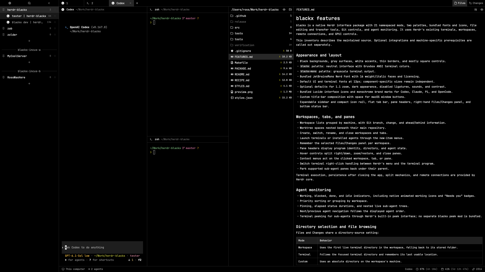
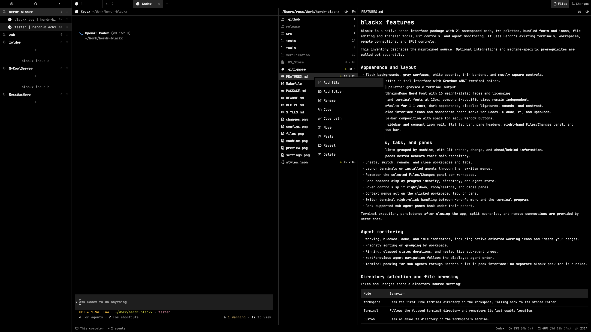
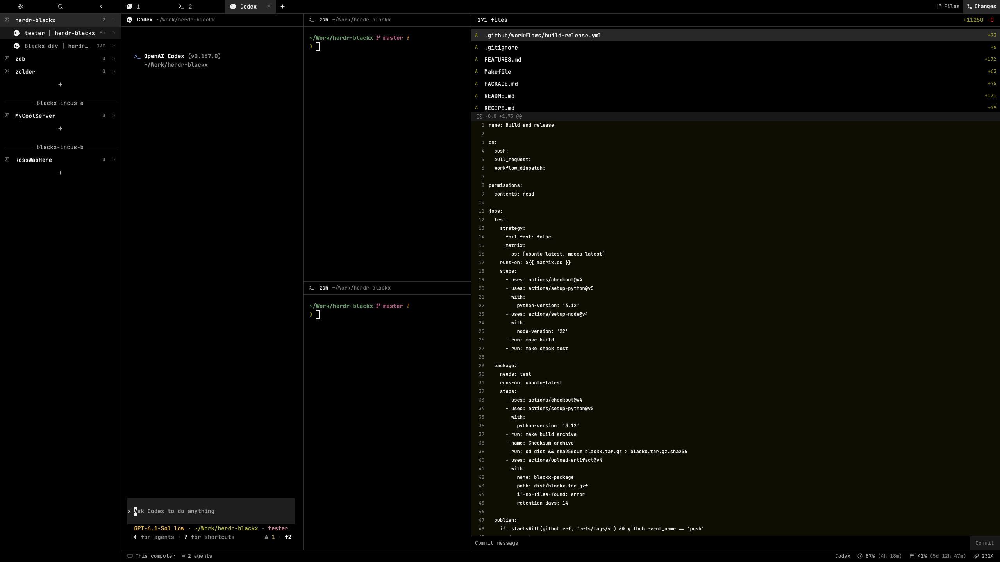
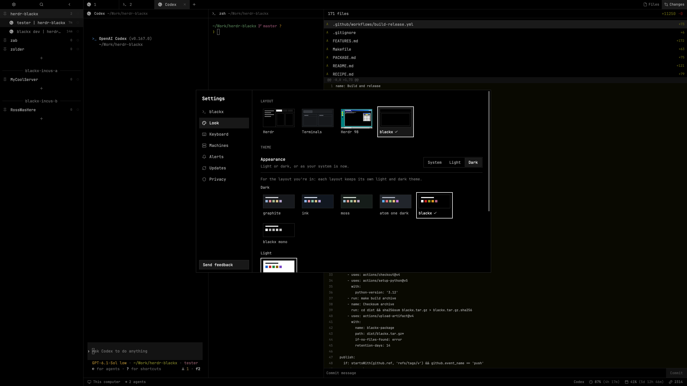

# blackx

Black canvas. Compact controls. Your agents, files, diffs, and remote machines within reach.

Blackx brings 21 native mods together into one Herdr workspace, with a monochrome interface and your choice of colored or grayscale terminal output.

[Install blackx](#install-blackx) · [Explore the features](docs/FEATURES.md) · [Make it yours](#make-it-yours)



## Keep the whole project in view

Run an agent, open a shell beside it, check what changed, and jump into a file—all in the same workspace.

- **Know who needs you.** Agent states, priority sorting, pins, and nested sub-agents keep attention where it matters.
- **Move between projects quickly.** Compact workspaces, flat tabs, a fuzzy command palette, and a searchable workspace picker.
- **Read and edit beside your terminal.** A file tree, built-in source editor, Markdown preview, and your preferred external editor when you want it.
- **Review the work.** Changed files, line-numbered diffs, and a commit action in the Changes panel.
- **Bring your other machines along.** Browse connected workspaces and copy or move files through Herdr’s existing connections.
- **Keep the look consistent.** Matching menus, dialogs, icons, pane headers, and settings, built with native Herdr controls.

## Files, without leaving the workspace

Follow the workspace directory, follow the active terminal, or choose a custom folder. Edit in place, toggle Markdown preview, wrap long lines, or open a file in your terminal editor.

The context menu handles new files and folders, rename, copy, move, paste, and Trash. Unsaved drafts survive save failures; conflicting changes get checked before writing.



## See what changed

Keep the diff next to the terminal that made it. Browse changed and untracked files, inspect additions and deletions, then write a commit message when you’re ready.

The Commit button stages **all** changes before committing. For selective staging, use your usual Git tools.



## Pick your kind of dark

**blackx** pairs a neutral black-and-gray interface with Gruvbox terminal colors. **blackx-mono** takes terminal output grayscale too.

JetBrainsMono Nerd Font is bundled, along with Lucide controls and monochrome Codex, Claude, Pi, and OpenCode marks. Optional Codex syntax themes and Claude Code settings help carry the look into your agents.



## Install blackx

Already using Herdr? Give your agent this prompt:

```text
Install the blackx layout from:
https://github.com/aasmpro/herdr-blackx/tree/master/release/blackx

Read my installed Herdr AGENTS.md, then the package README, RECIPE.md,
including its dependencies and access, and all package files.
Preserve my settings and shortcuts, resolve name collisions, validate
all blackx mods, and switch to the blackx layout and palette.
```

The [ready-to-install folder](release/blackx) includes the layout, mods, fonts, icons, themes, recipe, and preview. Recipients need no build tools. See the [package instructions](release/blackx/README.md) for manual installation and optional configuration fragments.

Built against **Herdr 0.1.13 on macOS**. File operations need Python 3 on participating machines; Linux Trash needs `gio`. Usage reporting needs provider setup, including adapting the current Codex helper’s executable path or supplying Claude’s usage bridge file. See [features and limitations](docs/FEATURES.md) before relying on a particular platform or integration.

## Make it yours

The source is here too. Change the style tokens, adjust a mod, rebuild the package, and try it locally.

```sh
make help       # Available commands
make build      # Generate release/blackx
make verify     # Check the package, tests, and native mods
make install    # First install; refuses existing names
make update     # Back up and update installed blackx files
make release    # Validate and create an optional local archive
```

| Looking for… | Start here |
| --- | --- |
| Everything blackx does | [Feature inventory](docs/FEATURES.md) |
| Setup, development, and releases | [Maintainer guide](docs/DEVELOPMENT.md) |
| Colors, typography, and spacing | [Style guide](docs/STYLES.md) |
| The installable package | [release/blackx](release/blackx) |
| Code and package sources | [src](src) |

Maintain source in `src/`, documentation and screenshots in `docs/`, and commit rebuilt `release/blackx` files alongside source changes. The package stays in this repository; optional archives live in the ignored `dist/` folder.
