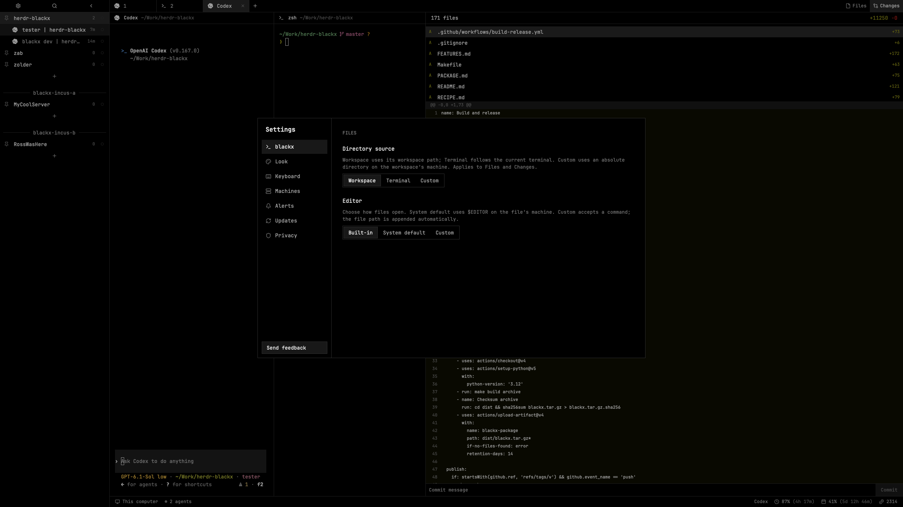
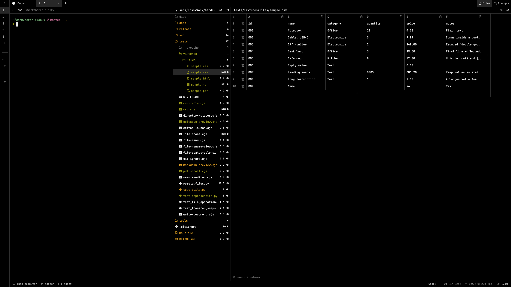
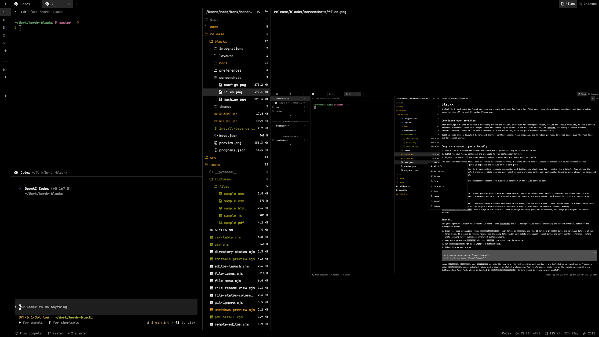
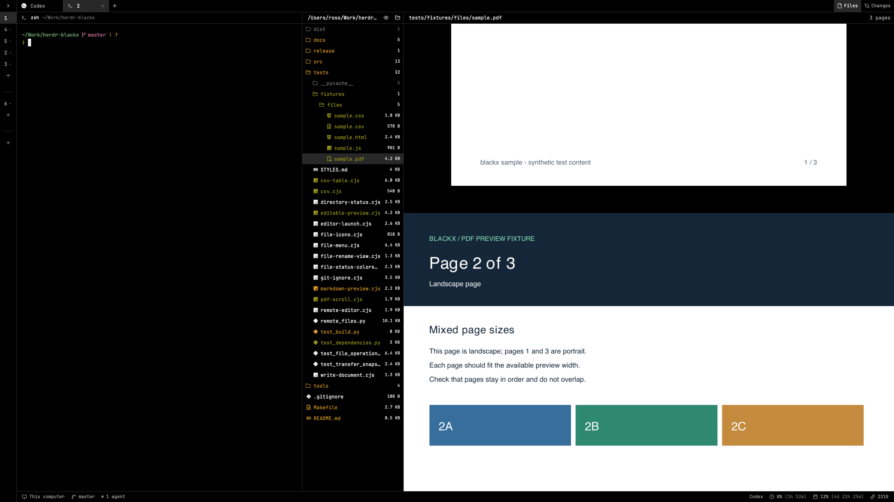
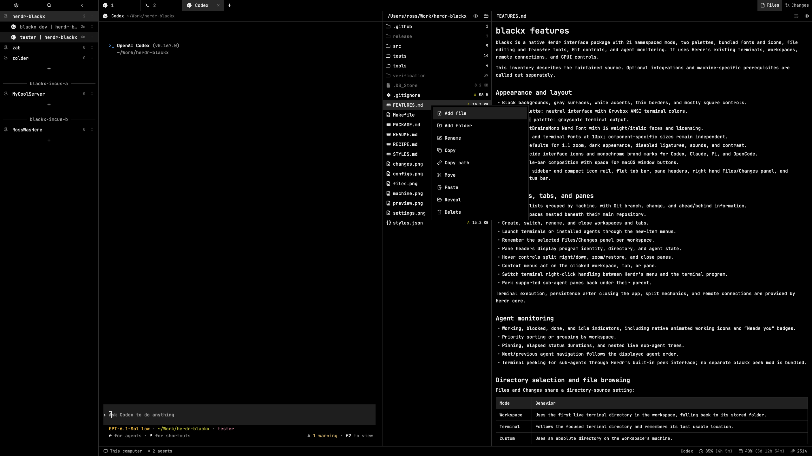
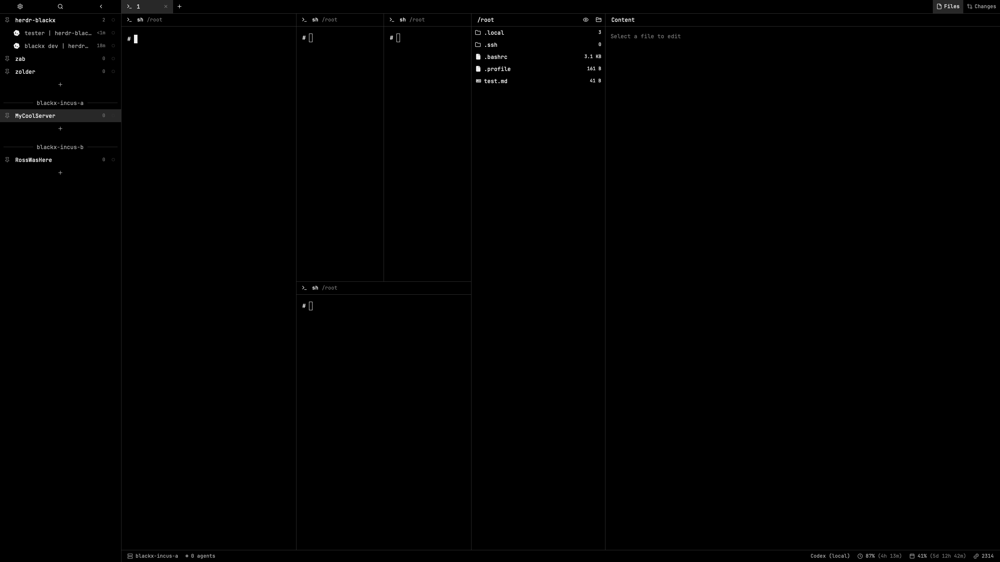

# blackx features

blackx is a native Herdr interface package with 21 namespaced mods, two palettes, bundled fonts and icons, file editing and transfer tools, Git controls, and agent monitoring. It uses Herdr’s existing terminals, workspaces, remote connections, and GPUI controls.

This inventory describes the maintained source. Optional integrations and machine-specific prerequisites are called out separately.

## Configure blackx for your workflow

Open **Settings → blackx** for the package’s directory and editor controls. These choices let you keep the workspace’s project folder steady, follow the terminal as its directory changes, or browse a custom absolute path. Files and Changes share the choice.

Choose the built-in viewer/editor, System default (`$EDITOR`), or a custom executable with quoted arguments. External commands run on the file’s machine, receive the file path automatically, and open in a new Herdr tab. Both external modes show a full-width file tree; returning to Built-in restores the content split and its saved tree width. Drafts must be saved before launching an external editor. These controls do not require hand-editing a configuration file.

## Appearance and layout

- Black backgrounds, gray surfaces, white accents, thin borders, and mostly square controls.
- `blackx` palette: neutral interface with Gruvbox ANSI terminal colors.
- `blackx-mono` palette: grayscale terminal output.
- Bundled JetBrainsMono Nerd Font with 16 weight/italic faces and licensing.
- Default UI and terminal fonts at 13px; component-specific sizes remain independent.
- Optional defaults for 1.1 zoom, dark appearance, disabled ligatures, sounds, and contrast.
- Bundled Lucide interface icons and monochrome brand marks for Codex, Claude, Pi, and OpenCode.
- Custom title-bar composition with space for macOS window buttons.
- Expandable sidebar and compact icon rail, flat tab bar, pane headers, right-hand Files/Changes panel, and bottom status bar.

## Workspaces, tabs, and panes

- Workspace lists grouped by machine, with Git branch, change, and ahead/behind information.
- Worktree spaces nested beneath their main repository.
- Create, switch, rename, and close workspaces and tabs.
- Launch terminals or installed agents through the new-item menus.
- Remember the selected Files/Changes panel per workspace.
- Pane headers display program identity, directory, and agent state.
- Hover controls split right/down, zoom/restore, and close panes.
- Context menus act on the clicked workspace, tab, or pane.
- Switch terminal right-click handling between Herdr’s menu and the terminal program.
- Park supported sub-agent panes back under their parent.

Terminal execution, persistence after closing the app, split mechanics, and remote connections are provided by Herdr core.

## Agent monitoring

- Working, blocked, done, and idle indicators, including native animated working icons and “Needs you” badges.
- Priority sorting or grouping by workspace.
- Pinning, elapsed status durations, and nested live sub-agent trees.
- Next/previous agent navigation follows the displayed agent order.
- Terminal peeking for sub-agents through Herdr’s built-in peek interface; no separate blackx peek mod is bundled.

## Directory selection and file browsing

Files and Changes share a directory-source setting:

| Mode | Behavior |
| --- | --- |
| Workspace | Uses the first live terminal directory in the workspace, falling back to its stored folder. |
| Terminal | Follows the focused terminal directory and remembers its last usable location. |
| Custom | Uses an absolute directory on the workspace’s machine. |

- Expandable local and connected-machine directory trees.
- Retained expanded folders and selected files when switching directory contexts.
- File refresh behavior and dimmed Git-ignored entries.
- Git status is expressed through file and directory colors, with no letter badges.
- Nerd Font file icons with 110 extension mappings, special filenames, folder states, and a fallback glyph.
- Resizable tree/content split for built-in editing.
- Full-width tree when an external editor is selected.

### Git colors in the file tree

Git status appears through filename and icon colors, without A/M/D/U letter badges. File sizes and directory counts keep their neutral styling.

| Item | Color |
| --- | --- |
| Modified file | Yellow |
| Added or untracked file | Green |
| Existing directory containing changed or added descendants | Yellow |
| New directory containing added/untracked files | Green |
| File with a deletion or conflict status | Red |
| Unchanged file or directory | Normal foreground |
| Git-ignored entry | Dimmed |

Directory colors propagate through every parent, including collapsed folders. For example, adding `src/new-folder/file.txt` makes an existing `src` yellow, while the new `new-folder` and `file.txt` are green. A modification to an existing nested file makes its existing ancestor directories yellow. Once changes are committed or reverted and the tree refreshes, clean entries return to their normal color.

“Existing” means present in Git’s last commit. Git does not track empty directories, so a previously empty folder receiving its first untracked file is treated as new. Before the first commit, added directories are green. Colors use the active theme’s ANSI palette; blackx-mono renders these roles in grayscale. Selection and hover backgrounds remain unchanged.

## File previews and editing

Set **Settings → blackx → Editor → Built-in** for native previews. System default (`$EDITOR`) and Custom still launch a terminal editor on the file's machine and show a full-width file tree.

| File type | Built-in view | Editing |
| --- | --- | --- |
| Markdown (`.md`, `.markdown`, `.mdown`, `.mkd`) | Rendered preview by default; eye icon switches to source | Click a block, edit its Markdown inline, then choose Done |
| CSV / TSV | Table preview by default; the same eye icon switches to source | Click a cell to edit, including multiline values |
| PNG, JPEG, WebP, GIF, SVG | Standalone image preview, fitted to the content width | Read only; decoding depends on Herdr's image loader |
| PDF | All pages in one vertical scroll; total page count at the header's right | Read only |
| HTML, CSS, JavaScript and other text | Source editor | Text editing; no live HTML/CSS/JavaScript preview |

### Shared source/preview control

Markdown and CSV/TSV open in preview by default. The eye icon in the content header switches to source and back. Both views edit the same draft. Save/Cmd-S performs the existing conflict-safe local/remote write; view switches and structural table edits do not save automatically. Failed saves keep edits. Oversized text remains read-only.

For Markdown, click a rendered block, edit its Markdown text inline, then choose Done to render it again. Other blocks remain visible. Fenced code and blank separators are preserved around edited blocks. This is block editing, without a rich-text formatting toolbar or automatic inline-media loading.

### CSV / TSV tables

Tables show column letters, row numbers, aligned cell borders, and horizontal scrolling. Click a cell for inline multiline editing. The first record stays editable, and row totals include it. Tables use pages of **100 rows**, with Previous/Next above the table when needed.

- The centered **+ strip below the rows** fills the table width and appends an empty row, opening its last page.
- The centered **+ strip on the right** matches the actual table height, excluding empty space below, and appends an empty column.
- Every row and column header has a trash icon. Confirm to remove that target from the draft; Cancel/Escape changes nothing. A changed draft invalidates an old confirmation. Removing the final row/column leaves an editable empty placeholder.
- The bottom status row contains only **N rows · M columns**.

Values stay strings, including leading zeros, Unicode and empty cells. Quoted delimiters, escaped quotes, multiline cells, UTF-8 BOM and LF/CRLF conventions are supported. Serialization can normalize quoting, without converting values to numbers, dates or formulas. Invalid CSV has a source-repair path. Sorting, filtering and spreadsheet formulas are not implemented.

### Images

Standalone PNG, JPEG, WebP, GIF and SVG files use Herdr's image loader. They are read-only, fit the content width and scroll vertically. The filename remains in the header; no PDF controls or read-only captions appear inside image content. There are no image-editing, animation or zoom controls.

### PDFs

All pages load progressively in order in one vertical scroll, including mixed portrait/landscape pages. The total page count stays at the header's right. Poppler renders page images locally and reuses the staged source for subsequent pages. A failure on a later page keeps earlier pages visible with an error message.

PDF previews are read-only page images, without text selection/search, password entry, editing, zoom, or Previous/Next page controls. Protected, corrupt or unreadable files can fail to render.

### Limits, cache and remote access

- Text editing: **400,000 characters**. Larger text is truncated/read-only and cannot be saved from its truncated preview.
- Image/PDF source size: **50 MiB**, with additional `hc` transport limits for remote previews. Rendering has subprocess timeouts and pages are scaled to at most 1,600 pixels along their longest dimension.
- Local/remote image and PDF sources are copied into `blackx-preview-cache/` under the selected Herdr home. This cache is separate from the file clipboard and portable package. Folders older than 24 hours are pruned when the helper runs.
- Reopen an image/PDF to refresh external changes. Text refreshes preserve dirty drafts and report conflicts.
- Poppler is local even for remote PDFs; Python 3 and the existing Herdr connection are needed at the remote endpoint. Linux file-transfer tests do not establish complete remote-preview or Windows coverage.

HTML/CSS/JavaScript are source-editable; **live HTML preview, inline Markdown media and audio/video playback remain unimplemented**. The HTML fixture demonstrates desired browser behavior and does not enable a browser inside Herdr.

## File and folder operations

The context menu offers Add file, Add folder, Rename, Copy, Move, Paste, Copy path, local Reveal, and Delete through system Trash.

- Creation targets the clicked folder, a file’s parent, or the tree root.
- Creation and rename refuse to overwrite existing entries; prompts retain input after errors.
- Rename follows selected files, expanded folders, and retained drafts.
- Copy and Move use blackx’s shared file clipboard; Copy path uses the system text clipboard.
- Duplicate handling offers Replace, Keep both, or Cancel.
- Copy into the source folder offers Keep both or Cancel; Move into the same folder is a no-op.
- Directory descendants are rejected as destinations.
- Delete requires confirmation and uses Trash rather than permanent deletion.

## Transfers between machines

Copy a server file to your laptop using the same menu as a local copy:

1. Select a connected server workspace and open its Files panel.
2. Right-click the source file or folder and choose **Copy**.
3. Switch to a local workspace and navigate to the destination.
4. Right-click the destination folder (or empty tree space for its root) and choose **Paste**.
5. If the destination already exists, choose Replace, Keep both, or Cancel.

The shared file clipboard remembers the source path, machine, and whether Copy or Move was selected across workspace switches. **Copy path** instead writes a path string to the system clipboard; pasting that text is not a file transfer. Copy retains the original. Move removes it only after the operation’s verification and source checks succeed.

- Supports server-to-local, local-to-server, server-to-server, and same-machine operations through existing `hc` connections.
- Transfers folders as well as files, using private snapshots, 2 MiB chunks, and destination checksum verification.
- Preserves symlinks; cross-machine folder transfers expand hard links into ordinary files.
- Warns about skipped sockets, pipes, devices, and entries disappearing during Copy.
- Retains sources on transfer failure and reports recovery staging paths when applicable.
- Applies stricter source-change checks to Move, including retaining sources with uncopied runtime entries.
- Allows up to ten minutes for large cross-machine operations.

Machines must already be connected through Herdr, with Python 3 on participating endpoints. Linux Trash requires `gio`; Reveal is local-only. Installation provisions missing runtime tools through `install-dependencies.sh`; see the package README for the dependency list. Linux remote endpoints have dedicated integration tests; this does not establish full Windows support.

## Git Changes panel

- Repository detection for the selected directory context.
- Changed and untracked file lists, insertion/deletion counts, text diffs, and new-file content.
- Support for repositories without an initial commit.
- Explanatory messages for binary, oversized, or unreadable content.
- Virtualized diff rows for long changes.
- Commit-message field and Commit action.

Commit runs `git add -A` followed by `git commit`: it stages all changes, not a selected subset.

## Status bar and usage

The footer combines workspace context with provider usage so you can see remaining allowance while working:

- Current machine, available Git branch, workspace agent count, and count needing attention.
- Command-palette hint based on the actual shortcut binding.
- Claude usage when the focused program is Claude; Codex otherwise, with per-provider cached readings.
- **Remaining** percentages, calculated from reported used percentages, and reset countdowns for the available primary and secondary windows.
- Codex credit balance or an unlimited indicator when supplied by the provider.
- Automatic refresh every 15 seconds and click-to-refresh controls; stale markers, unknown values, and an unavailable/retry state when data cannot be read.

These are provider allowance readings, not per-project token consumption or remote-account usage. Selecting a remote workspace adds a **(local)** label: its machine name refers to the workspace, while the usage still comes from this computer.

| Provider | Current setup requirement |
| --- | --- |
| Codex | A local authenticated Codex app-server. The helper currently contains a machine-specific executable path and PATH prefix; adapt these on other installations. |
| Claude | An external process must populate `~/.ai-usage-bridge/claude.json` with usage windows and update/reset timestamps. The bridge process is not supplied by the package. |

Missing data does not imply unlimited quota. Errors and readings older than five minutes mark the provider stale; expired or unavailable window data shows an unknown percentage rather than a fabricated allowance.

## Dialogs, search, and settings

Styled interfaces include Settings, fuzzy command palette, workspace/tab picker, context and new-item menus, rename prompts, close-tab/workspace confirmations, worktree dialogs, add-machine interface, keybinding help, feedback, welcome, and release notes.

- Palette supports recent commands, fuzzy search, and keyboard navigation.
- Keybinding help is searchable.
- Settings expose appearance, fonts, zoom, Option-key behavior, sounds, machine management, updates, privacy controls, and directory/editor choices.
- Worktree dialogs create, open, and remove worktrees using Herdr’s capabilities.
- Feedback supports screenshot attachments and an explicit Send action.

Styling covers actions routed through blackx. Direct CLI commands, OS menu actions, and some built-in interfaces can still open Herdr’s default screens. Herdr does not expose a global dialog override.

## Shortcuts and optional configuration

Merge the minimal package `keys.json` into personal bindings:

| Binding | Action |
| --- | --- |
| `cmd-,` | Settings |
| `cmd-shift-p` | Command palette |
| `cmd-p` | Workspace/tab picker |
| `cmd-w` | Close-tab confirmation |
| `f2` | Rename tab |
| `shift-f2` | Rename workspace |
| `cmd-/`, `cmd-shift-/` | Keybinding help |

Optional package files include full settings/shortcut merge fragments, font defaults, program-icon overrides, Codex `blackx` and `blackx-mono` syntax themes, and a Claude Code `dark-ansi` settings fragment.

These require explicit installation or merging. Agent themes affect those tools globally, not just this Herdr layout. Preserve unrelated settings, shortcuts, program launch commands, and matching rules. Runtime workspace state and machine connections are not distributed.

## Development and distribution

- Central style tokens in [styles.json](../src/styles.json).
- Deterministic Python builder producing self-contained native mod assets.
- Installer refuses collisions by default; updates create rollback backups.
- Optional palette/font settings sync preserves unrelated preferences.
- [Makefile](../Makefile) targets for building, tests, installation, updates, native checks, archives, and remote integration tests; run `make help`.
- Python and JavaScript test suites plus real `hc` endpoint integration tests.
- Local build, validation, and optional archive commands; no GitHub Actions or automatic publishing.
- Ready-to-install `release/blackx` package committed alongside source; optional `dist/` archives excluded from Git.

Before publishing, run local native Herdr checks and exercise changed views. Real remote endpoint tests require available, connected machines.

## Compatibility and documentation

Tested with Herdr 0.1.13 and 0.1.14 on macOS. Linux remote endpoints have dedicated integration tests; Windows and broader remote behavior remain incompletely validated. Personal copies of Herdr interfaces require review after Herdr upgrades.

The current source includes editable Markdown/CSV previews, standalone image viewing, continuous read-only PDF pages, automatic local dependency setup, Custom editor commands, directory-source selection, and Claude bridge-file usage reporting.

For installation and development, see [maintainer guide](DEVELOPMENT.md). For package behavior and dependencies, see [RECIPE.md](../src/RECIPE.md).
