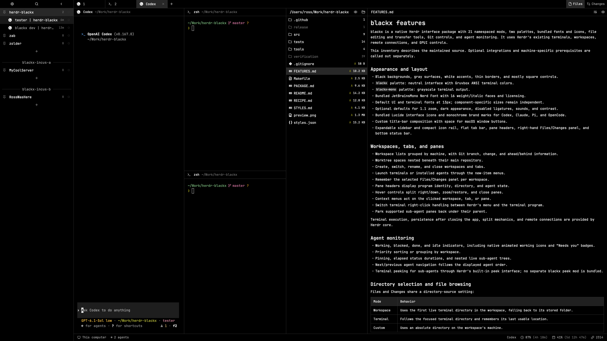

# blackx

A native Herdr layout with the blackx theme and 21 namespaced `blackx-*` mods.



## Install

Ask your agent to install this folder in Herdr. Read `RECIPE.md` and all package files first, including the listed external commands and filesystem access.

1. Check for name collisions. Copy `layouts/blackx.json`, both files in `themes/`, and the 21 folders in `mods/` into the matching folders of your Herdr home. If a name is taken, rename the incoming file/folder and update its layout, asset paths and self-overlay references before installation; never overwrite unrelated customizations.
2. Keep each generated `style.js` with its `main.js`. No build tool is required.
3. Run `herdr-app check` for each installed `blackx-*` mod.
4. Select blackx and blackx:

```sh
herdr-app do layout.switch '{"name":"blackx"}'
herdr-app do app.theme '{"name":"blackx"}'
```

Leave `README.md`, `RECIPE.md`, and `preview.png` outside the app home. Current settings and shortcuts are included as optional merge fragments under `preferences/`; merge selected values and preserve unrelated preferences. Font preferences remain yours; the sample screenshot uses JetBrainsMono Nerd Font, which is bundled in `mods/blackx-chrome/fonts`. Herdr's built-in fonts remain available.

## Dependencies and access

Baseline: Herdr 0.1.13. Uses native GPUI/gpui-base APIs and Herdr overlays. Git provides status/diffs; Commit explicitly runs `git add -A` then `git commit`. Directory browsing uses sh or PowerShell locally or on the selected machine. File operations and transfers use Python 3 and hc; Linux Trash needs gio. Saves write project files with conflict checks. Machine controls use hc and configured network connections; worktree operations may fetch through Git. Usage runs Python 3: Codex starts a local app-server and reads account rate limits, while Claude reads `~/.ai-usage-bridge/claude.json`. The current Codex helper has a machine-specific executable path; adapt it for another installation. No credentials or usage data are bundled. Feedback sends only through Herdr's API after the person clicks Send; updates use Herdr's built-in APIs.

## Share

Place this folder in a public GitHub repository and add the repo topic `herdr-layout`, following Herdr's sharing instructions. This is one layout bundle, not 21 separately published mods. See `RECIPE.md` for behavior and acceptance checks. Maintainer style sources and optional build tools are kept outside this native release folder.

## Secondary interfaces

Includes namespaced Settings, command palette, picker, menus, prompts, confirmations and machine/worktree dialogs. Merge package keys.json into personal bindings; it contains layout:blackx overrides for settings, palette, picker, close tab, rename tab/space, and keybind help. Never replace personal keys.json. Blackx routes close/rename shortcuts, keybind help, feedback, welcome, and release notes through its styled dialogs. Direct CLI commands and OS menu actions still use Herdr screens because the app exposes no global dialog override. Personal copies are pinned to the inspected Herdr version and require review after upgrades.

Two palettes are bundled: `blackx` preserves colored ANSI terminal output; `blackx-mono` uses the existing grayscale Monochrome palette. Select either in the theme picker.

The blackx palette uses Gruvbox Dark neutral/bright red, green, yellow, blue, purple and aqua for ANSI color slots (https://github.com/morhetz/gruvbox). Neutral UI colors remain black/gray/white; blackx-mono remains grayscale.

## Agent themes (optional)

Codex: copy `integrations/codex/blackx.tmTheme` into `$CODEX_HOME/themes` and select blackx with `/theme` (or set `tui.theme = "blackx"`). This styles code/diff syntax; fixed application accents are not universally overridable. Claude Code: merge `integrations/claude/settings.fragment.json` into your user settings to use `dark-ansi`, which follows the active terminal palette. Do not overwrite existing agent settings. Agent settings are global to those tools, not scoped to the Herdr layout. Restart or reselect the theme in existing sessions.

Codex also includes `integrations/codex/blackx-mono.tmTheme`: install alongside blackx and choose `blackx-mono` with `/theme`. For Claude Code, keep `dark-ansi` and select Herdr’s `blackx-mono` palette; it follows the terminal automatically, with no separate Claude theme file.

## Bundled fonts and defaults

JetBrainsMono Nerd Font (Nerd Fonts 3.5.1 / upstream 2.304) is bundled unchanged, including 16 weight/italic faces, OFL.txt and embedded copyright notices in `mods/blackx-chrome/fonts`. Herdr loads bundled fonts on startup or the next look change. Layout defaults explicitly use this family for both UI and terminals at 13px; existing component-specific text sizes remain intact. `preferences/font-defaults.json` additionally records zoom 1.1, ligatures off, and minimum_contrast 1. Merge this fragment into settings.json to reproduce the complete preference setup, preserving unrelated keys; do not replace the file. Maintainers can use `tools/install.py --update --sync-style-settings` to apply those preferences.

## Icons

All custom UI icon rendering resolves through bundled Lucide static 1.70.0, with generic Lucide symbols replacing program/agent brand marks. Icons are tinted by the design system; layout preview images remain actual artwork. Each mod includes local icon assets and LICENSE. Merge package programs.json icon overrides into personal programs.json to apply generic icons in built-in Herdr screens, preserving existing run/match settings. No app-owned icons or frame files are replaced. Terminal applications draw their own logos separately.

Brand exceptions: Codex, Claude, Pi and OpenCode use monochrome Lobe Icons 1.102.0 SVG marks (currentColor, 24×24); Terminal and the remaining UI use Lucide. Lobe licensing/attribution is bundled alongside the SVGs. These override the earlier generic Bot mapping for those four agents.

## Configured file editor

Choose Built-in, System default, or Custom under Settings → blackx. Built-in edits source with Save/Cmd-S, line wrapping, retained drafts, and a Markdown preview toggle. System default uses `$EDITOR` on the file's machine; Custom accepts an executable and quoted arguments. Both external modes append the file path and launch a new Herdr tab; shell substitutions and control operators are rejected. Save dirty native drafts before launching an external editor. Passive refresh/restoration does not launch editor tabs.

Directory source can use the workspace path, follow the terminal, or use a custom absolute path on the workspace's machine. This applies to Files and Changes.

In either external editor mode, Files shows only the full-width tree; the content column and divider are hidden. Selecting a file still opens the system editor in a new tab. Built-in mode restores the split view and its saved tree width. Launch errors remain visible below the tree.

Directory-tree icons use Nerd Fonts 3.5.1 glyphs from the bundled JetBrainsMono Nerd Font, with 110 extension mappings, special config/manifest filenames, open/closed folders, and a generic fallback. Labels and glyphs retain muted monochrome styling. Other controls continue using Lucide and the selected brand marks.

Files context menu: Copy and Move use Blackx’s shared file clipboard; Copy path uses the system text clipboard. Paste targets a folder, a file’s parent, or empty-space root. Duplicates offer Replace, Keep both, or Cancel. Delete confirms and uses system Trash, never permanent deletion. Reveal is local-only. File operations require python3 on participating machines; Linux Trash requires gio. Cross-machine transfers stream via existing hc connections, verify content hashes, and retain the source on transfer failure. Failed transfers report their staging folder for recovery. Windows requires python3 on PATH. No dependencies are installed automatically.

Files menu starts with Add file, Add folder, and Rename. Creation targets the clicked folder, a clicked file’s parent, or the root on empty-space clicks. Prompts accept one item name, support Enter/Cancel, and retain input on errors. Existing items are never overwritten by these actions. Rename follows the selected file, expanded folders, and retained drafts. Empty-space menus disable Rename.

Copy/Paste in the source folder offers Keep both or Cancel; Move into the same folder is a no-op. Real folder descendants are still rejected. Cross-machine folder transfers expand hard links into ordinary files while preserving symlinks, and allow up to ten minutes for large transfers. Remote text files up to the existing editor limit are editable; saves use private transient request files, streamed stdin, conflict checks, and atomic replacement. Failed saves keep the draft.

Cross-machine copies use private per-file snapshots and 2 MiB chunks to stay below hc’s 8 MiB message limit. Runtime sockets, pipes/devices, and entries that disappear during Copy are skipped and reported in a warning. Checksums verify every archived file at the destination. Move retains stricter source-change checks and does not remove a source containing uncopied runtime entries.

## Current configuration fragments

`preferences/settings.fragment.json` contains the current blackx settings (palette overrides, fonts, zoom, appearance, ligatures, contrast and sounds). `preferences/keys.fragment.json` contains the current global, terminal and blackx shortcut configuration. Merge selected values into personal files; do not replace unrelated settings or bindings. Root `keys.json` remains the minimal blackx-only shortcut fragment. Runtime workspace state, machine connections and backups are not part of the portable package.

Text selection targets the active directory row color (`#282828`). Native inputs compensate for their 50% selection blend. Herdr’s native content editor additionally dims selections according to focus; the installed API does not expose that opacity, so editor highlights can appear darker than the selected tree row.
