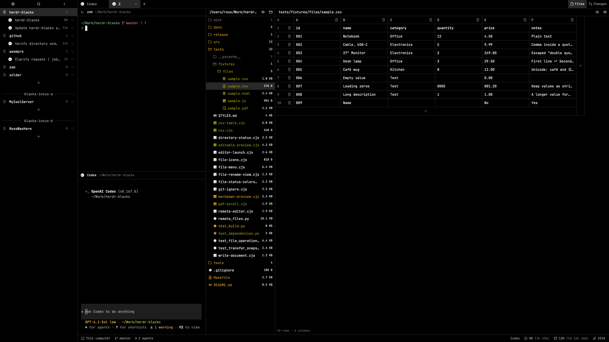
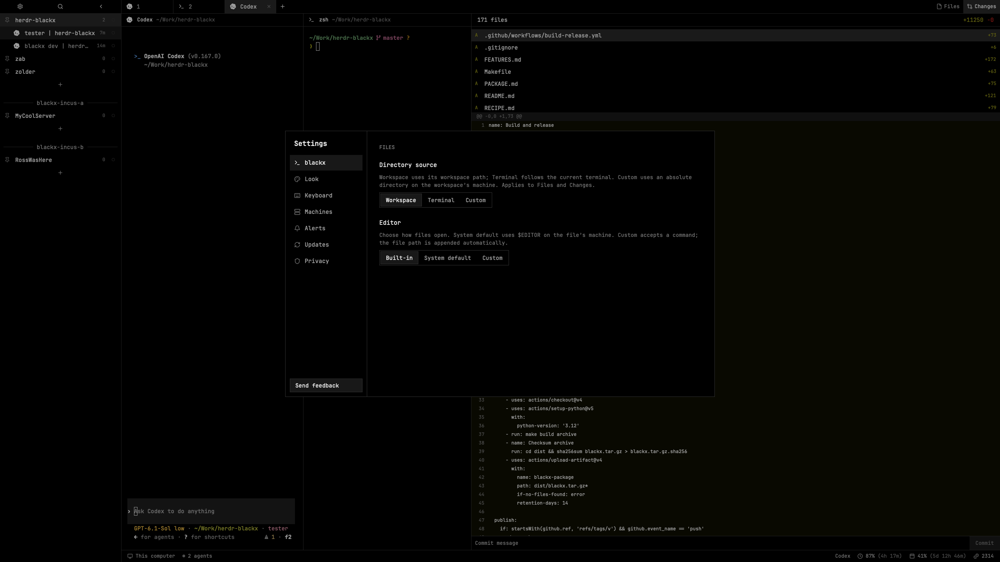
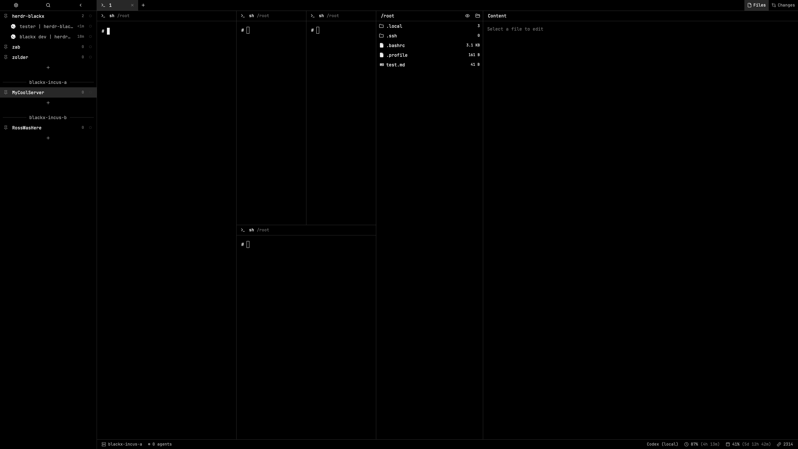
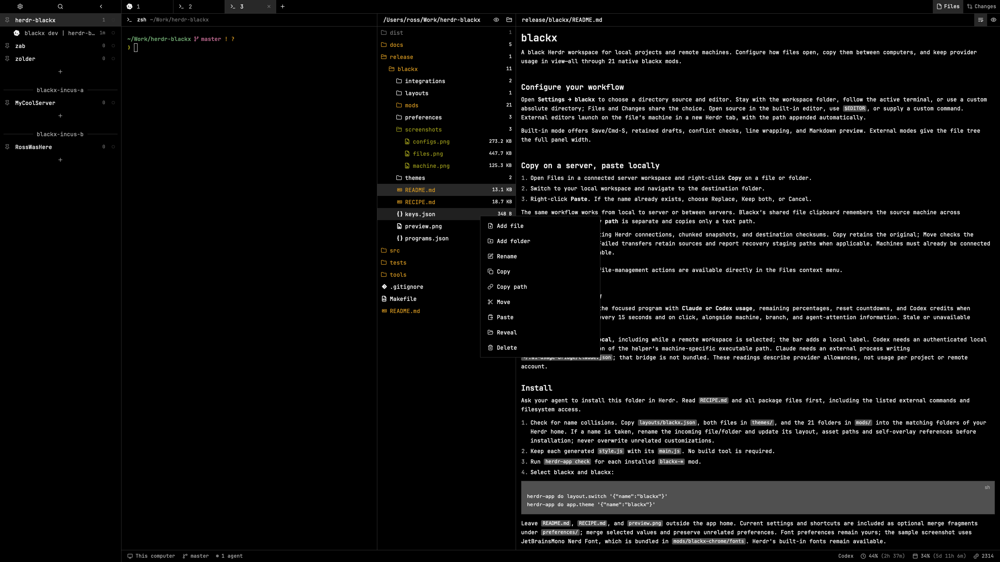

# blackx

A native, flat black Herdr workspace for local projects and remote machines: configure where Files looks and how files open, copy a folder from a server and paste it locally, and watch remaining agent usage in a slim status bar. Compact spaces and agents sit on the left, terminals in the center, and project tools on the right.

## What you see

The canvas, sidebar, and terminal backgrounds are black (`#000000`). Main text is `#eeeeee`, muted text `#aaaaaa`, dim text `#777777`, borders `#303030`, hover `#202020`, selected rows `#282828`, raised surfaces `#181818`, and popovers `#101010`. Controls are predominantly square. The UI and terminal use JetBrainsMono Nerd Font at a base 13px, with smaller labels and status captions.

Left to right and top to bottom:

- A 268px sidebar, collapsible to a 44px rail or 76px on macOS. Compact rendering begins below 160px. Its 32px top strip contains settings, search, and collapse controls. The list below groups workspaces by machine, nests worktrees under their repository, and shows agents and sub-agents with status and elapsed-time labels.
- A 32px flat tab strip with program icons, a new-tab button, and Files/Changes panel toggles.
- Active terminals arranged in splits. Each pane has a 30px header showing program identity and current directory, then the terminal with 14px vertical and 12px horizontal padding. Pane frames have zero border and radius, with 1px gaps.
- A right panel, initially hidden, 368px wide with a 280px minimum. Files contains a directory tree and a content viewer/editor separated by a draggable divider. External editor modes show the tree alone. Changes contains changed files, a line-numbered diff, and a commit-message area. Diff rows are 20px high.
- A 28px bottom bar showing machine, available branch, agent and attention counts, a command shortcut hint, and available usage percentages/reset countdowns.

The blackx configuration screen groups Directory source (Workspace, Terminal, Custom) and Editor (Built-in, System default, Custom), with a text field revealed for custom choices. It uses the same flat black controls and selected-state treatment as the rest of the interface.

Remote workspaces remain grouped by machine, and Files shows the selected server’s directory. The footer identifies that machine while labeling provider usage as local.

Menus have monochrome action icons and thin borders. Workspace/tab add menus and the Files context menu have 5px internal padding. Bundle Lucide interface icons, Lobe marks for Codex/Claude/Pi/OpenCode, and Nerd Font file glyphs with 110 extension mappings and special filenames. Preserve font/icon licenses. Optional preferences reproduce 1.1 zoom and disabled ligatures; existing saved widths may override defaults.

## How it behaves

**Navigation and agents.** Clicking a workspace, tab, or agent focuses it. Right-click opens a blackx context menu for the item clicked; double-clicking a tab renames it. Workspace/tab reorder operations stay within Herdr's permitted boundaries. Sidebar collapse preserves its expanded width. Agent sorting offers Priority and Grouped by space, pinning, collapsible groups, and nested live sub-agents. Agent navigation follows the visible list order. A working agent has a rotating spinner; blocked shows “Needs you” or a compact exclamation; done shows a dot; idle has a ring. Priority is blocked, done, working, idle. Preserve the currently viewed agent's held ranking as done changes to idle. Sub-agent clicks can open Herdr's terminal peek.

**Tabs and panes.** The add menu starts a terminal or installed agent; the workspace add menu offers workspace/worktree actions. Pane hover reveals split right/down, zoom/restore, and close. Menus act on the clicked target rather than assuming keyboard focus. Tab/workspace closure opens a confirmation explaining that its terminals end. Closing a pane uses Herdr's normal close action. Pane right-click routing can be switched between Herdr and the terminal application. Panel selection is remembered per workspace.

**Files and editing.** Directory source has Workspace, Terminal, and Custom modes. Workspace uses the first live terminal directory, falling back to the workspace folder. Terminal follows the focused terminal and remembers a usable directory. Custom requires an absolute path on the workspace's machine. Changes uses the same directory selection. Remember expanded folders, selected files, hidden-file preference, tree width, and line wrapping. Watch local directories and refresh periodically; remote directories use polling. Dim ignored entries. Color modified file labels/icons with the theme’s yellow and added/untracked files with green; conflicts/deletions use red. Omit Git status letter badges and keep size/count text neutral. Colors follow the active palette. Directory colors propagate through all ancestors: directories present in the last commit show yellow when descendants change; new directories show green. Git does not track empty directories; a previously empty folder with its first untracked file counts as new, as do added directories before the first commit. For example, adding `src/new-folder/file.txt` makes committed `src` yellow and the new folder/file green. Refreshing clean status clears these colors. The monochrome palette renders the same roles in grayscale.

Click folders to expand and files to open. Built-in mode provides editable source, Save/Cmd-S, wrapping, and a Markdown preview toggle. Retain drafts and show conflicts or save errors without discarding edits. Large text becomes a truncated read-only preview; binary content shows an explanation. System default uses the file machine's editor preference; Custom uses a supplied command. External editors launch in a new tab with the file path appended, only after a deliberate file-opening action. Do not launch from passive refresh/restoration. Require dirty native drafts to be saved first.

**File operations.** The primary cross-machine workflow is: open a connected server workspace, Copy a file or folder in Files, switch to a local workspace, and Paste into its destination folder. Support the reverse direction and server-to-server transfers identically. The shared clipboard must retain the source path, machine, and Copy/Move intent across workspace changes; Copy path instead writes only path text. Icon rows offer Add file, Add folder, Rename, Copy, Copy path, Move, Paste, Reveal, and Delete. Creation targets a folder, a file's parent, or the tree root. Creation/rename never overwrite existing entries; Enter submits and Cancel dismisses, with input retained on failure. Rename retargets the selection, expanded folders, and drafts. Copy/Move share a file clipboard; Copy path writes text to the system clipboard. Reveal is local-only. Paste uses the clicked destination; duplicates offer Replace/Keep both/Cancel. Same-folder Copy offers Keep both/Cancel, while same-folder Move is a no-op. Reject real descendant destinations. Delete confirms and uses system Trash.

Transfers work locally and through connected machines, verify content, and keep sources after failure. Report recovery staging paths. Preserve symlinks and expand cross-machine hard links into ordinary files. Warn about skipped runtime entries or files disappearing during Copy. Move applies stricter source-change checks and retains sources with uncopied runtime entries.

**Changes and usage.** Show changed/untracked paths, counts, and bounded text diffs, including repositories without an initial commit. Commit requires an explicit click and a message, stages all changes, then commits. Usage follows the focused program: Claude or otherwise Codex, with separate cached readings. Display remaining allowance (100 minus reported used percent), primary/secondary reset countdowns, and Codex credits or an unlimited-credit indicator when reported. Show unknown percentages for expired/unavailable window data, and mark errors or readings older than five minutes stale. Refresh every 15 seconds and on click. This is provider allowance, not per-project consumption. Usage is local even when viewing a remote workspace, and is labeled accordingly.

**Secondary screens.** Provide styled settings, fuzzy command palette with recent commands, workspace/tab picker, searchable keybinding help, prompts, confirmations, worktree and machine dialogs, welcome, release notes, and feedback with optional screenshots. Feedback sends only on explicit submission. Route blackx actions through these screens; direct CLI/OS menu actions may still open Herdr defaults.

Merge only the desired shortcuts: Cmd-comma settings, Cmd-Shift-P palette, Cmd-P picker, Cmd-W close-tab confirmation, F2 rename tab, Shift-F2 rename workspace, and Cmd-/ or Cmd-Shift-/ keybinding help. Other shortcuts remain the person's choices.

## Built from

Build a native package with `layouts/blackx.json`, `mods/blackx-*/`, `themes/blackx.json`, `themes/blackx-mono.json`, `keys.json`, this recipe, and `preview.png`. Include the configuration, machine, and Files context-menu screenshots under `screenshots/` so the package README and recipe remain readable without the source repository. Optional integration, preference, and program-icon fragments can accompany it. Installation requires no builder. Each mod has a default-exported View, a `mod.json`, and local resolved style/icon/helper modules; no runtime cross-mod code imports are required.

The layout is a root row: sidebar column (`brand`, `sidebar-lists/spaces`) and work column (`tabs`, `work-body`, `status`). The spaces block uses blackx-agents, which composes the space list. Work-body is a row of the active-tab terminal tree and an initially hidden panel column whose stack contains Files and Changes. Pane headers use blackx-pane. Hide the system title bar, position macOS traffic lights at [12,16], and use blackx-menu for terminal context menus.

The 21 mods and their roles are:

| Mod | Role and inputs |
| --- | --- |
| blackx-chrome | Top strip; sidebar control; keyboard command bridge; native selection styling. |
| blackx-agents | Main combined sidebar; agent priority/grouping/pins/sub-agent trees; `{sortMenu:true}` opens its sorting menu. |
| blackx-spaces | Workspace/machine/Git/worktree listing; also composed through the agents mod's space-view helper. |
| blackx-tabs | Tabs, add menu, panel toggles, per-workspace panel state. |
| blackx-pane | Header for the supplied pane/terminal context; focus and hover controls. |
| blackx-files | Directory tree/editor; `{fileMenu:true,path,destination,on,rootMenu?}` renders its operations popup. |
| blackx-changes | Directory-context Git status/diff/commit panel. |
| blackx-status | Machine/branch/agent footer and local usage helper. |
| blackx-settings | Appearance, keyboard, machines, alerts, updates, privacy, directory/editor configuration. |
| blackx-palette | Fuzzy command search, recents, argument prompts, keyboard navigation. |
| blackx-picker | Workspace/tab search and switching. |
| blackx-menu | Context popup with `{tab,target}` for pane, tab, space, or global actions. |
| blackx-new-menu | Terminal/agent launcher; `{mode:"spaces",machine?}` selects workspace actions. |
| blackx-prompt | `{title,value,hint?,command:{name,args}}`; submit a name to the command. |
| blackx-confirm | `{title,detail,command:{name,args}}`; explicit confirmation or cancellation. |
| blackx-worktree | `{space,folder?,action}` for new/open/remove; optional branch/tab/argv for direct creation. |
| blackx-machine-add | SSH-host selection/connection flow; `{part:"bar",target}` draws its live-terminal overlay header. |
| blackx-help | Searchable current keybindings. |
| blackx-feedback | Message/email/screenshots and explicit submission; optional `{message,from}` draft inputs. |
| blackx-welcome | Four-page onboarding with machine and panel choices. |
| blackx-whatsnew | Release notes from optional `{notes}` or current update data. |

Overlays receive their own `overlay` identifier and close through the app API. Route built-in screen names to blackx equivalents and request frameless overlays so blackx draws the border. Keep close/rename target IDs and pass `confirmed:true` only after the person confirms. Use native keyboard focus, Input/Editor/Markdown controls, virtual lists, and native animations.

Use reactive `spaces`, `agents`, `terminals`, `panes`, `focused`, `theme`, `layout`, `settings`, `keys`, `updates`, `shared`/`setShared`, and per-copy localStorage. Use `run` for workspace/tab selection, rename, move, close, pane split/zoom/focus, terminal peek/park/right-click routing, layout visibility/resize, theme and update commands. Use `nextCommand` for the chrome shortcut bridge; `openOverlay`/`closeOverlay` for dialogs; file read/write/watch APIs for local content and conflict-safe saves. Refresh external work with spawn/timers, passing the callback's current context. Never poll reactive app state or animate with timers.

External programs/access: Git for status, diffs, worktrees, staging and commits; sh/PowerShell for directory/editor/home queries; hc for machines, live terminals and remote execution; Python 3 for operations, transfers, remote saves and usage; native platform Trash/Reveal tools (Linux Trash uses gio). Cross-machine operations use existing hc connections, private snapshots, 2 MiB chunks, checksums, and up to 600,000ms timeouts. Remote saves stage a private request locally, stream it to the target, compare original content, atomically replace, and clean up transient requests.

The current Codex usage helper starts `/Users/ross/.nvm/versions/node/v24.20.0/bin/codex app-server`, initializes it and requests `account/rateLimits/read`; it is not a session-log reader. Claude reads `~/.ai-usage-bridge/claude.json` supplied by an external bridge. Preserve unavailable/retry states. Theme integrations provide Codex blackx/blackx-mono syntax themes and a Claude dark-ansi fragment; these are optional global tool preferences.

Bundle unmodified JetBrainsMono Nerd Font (Nerd Fonts 3.5.1/upstream 2.304), Lucide static 1.70.0, and Lobe Icons 1.102.0 assets with their notices/licenses. Use local icons and theme tinting. Herdr's built-in peek remains a dependency. Feedback, update checks and machine connections can reach the network through Herdr/core; Git worktree operations may fetch. No credentials, usage data, or machine connection records belong in the package.

## Watch out

Tested with Herdr 0.1.13 and 0.1.14 on macOS. Original clone provenance remains 0.1.13. Linux remote endpoints have integration tests; Windows is not comprehensively validated. Read the installed API/manual for another version and clone shipped components rather than editing app-owned files. Keep node IDs, mod names, shared keys and storage names stable where persistence matters. Merge shortcuts and program-icon preferences; do not overwrite unrelated bindings, launch commands, or settings.

The Codex executable path above is machine-specific and needs adaptation on another installation. Claude's bridge is not bundled. External editor commands accept executable/quoted arguments, not shell operators or substitution; an unset editor reports an error with no fallback. The current external-editor lookup uses sh, so Windows editor launching needs separate validation. Custom directory paths must be absolute. Preserve the selected workspace's machine when reading or executing remotely; remote usage readings are still local.

Limit Files to 500 entries per folder and 5,000 total. Text up to 400,000 characters is editable; larger text is truncated/read-only. Changes displays at most 1,000 status entries and 1,500 diff lines, truncating lines beyond 4,000 characters. Native virtual-list geometry must equal the rendered 20px diff rows. Binary files do not have a text editor/diff. Deletion needs a functioning Trash backend; never silently fall back to permanent removal.

Theme picker and saved layout sizes can override defaults. Native inputs blend accent at half opacity, so compensate the input accent to match selected-row color. Terminal selection and optional settings selection are separate roles. Derive typography from layout/settings where supported; preserve the Changes panel's existing diff-font policy. Initial mod checks do not exercise deferred rows, async tasks or full geometry. Hidden mod copies can remain alive; avoid unnecessary polling and global side effects.

This brief is self-contained: a fresh implementation must not need the maintainer's style sources or builder. In the source repository, those tools generate the committed native package; they are not runtime dependencies. Keep `preview.png` an actual screenshot, review its visible content before public sharing, and do not include private runtime state or backups.

## Done when

- All 21 installed mods pass `herdr-app check`; switching to blackx renders without new runtime errors.
- Expanded/compact sidebar, pane hover controls, tabs, panel switching, both palettes, and all four agent states render correctly. Agent sorting/pinning/sub-agent navigation works without disruptive reordering.
- Blackx menus show matching icons, borders, hover/disabled states and 5px Files/add-menu padding. Close-tab/workspace confirmations cancel safely and target the intended item.
- File-tree colors cover modified/added files, existing ancestors with newly added descendants, new nested folders, staged additions, and repositories with no commits. Verify propagation while collapsed, neutral sizes/counts, dimmed ignored entries, unchanged selection backgrounds, and clearing after commit/revert.
- Files follows each directory mode on the correct machine. Built-in Save/Cmd-S, Markdown preview and wrapping work; external editors launch only from deliberate actions. Conflicts and failures preserve drafts.
- Create, rename, copy, move, duplicate, paste and Trash behave as described; test local and available remote endpoints, hashes, Unicode/symlinks, same-folder operations and failure recovery separately.
- Changes handles new and existing repositories, aligned diff scrolling and binary/limit messages; explicit Commit stages all changes and commits the supplied message.
- Copy a server file/folder, switch to a local workspace, and Paste successfully; verify the reverse and server-to-server flow on connected test endpoints. The file clipboard retains its source machine, while Copy path produces text only.
- Usage refresh/countdowns, credits when available, unavailable and stale states work with available providers; local data is labeled on remote workspaces. Optional themes/settings do not replace unrelated preferences.
- Settings, help, palette, picker, worktree/machine dialogs and secondary screens open; feedback is not sent without explicit submission.
- The package folder contains its layout, all mod dependencies, both themes, shortcut fragment, recipe, licenses and real preview. Local build/check/tests reproduce the generated package; supported-platform claims match actual runtime verification.
